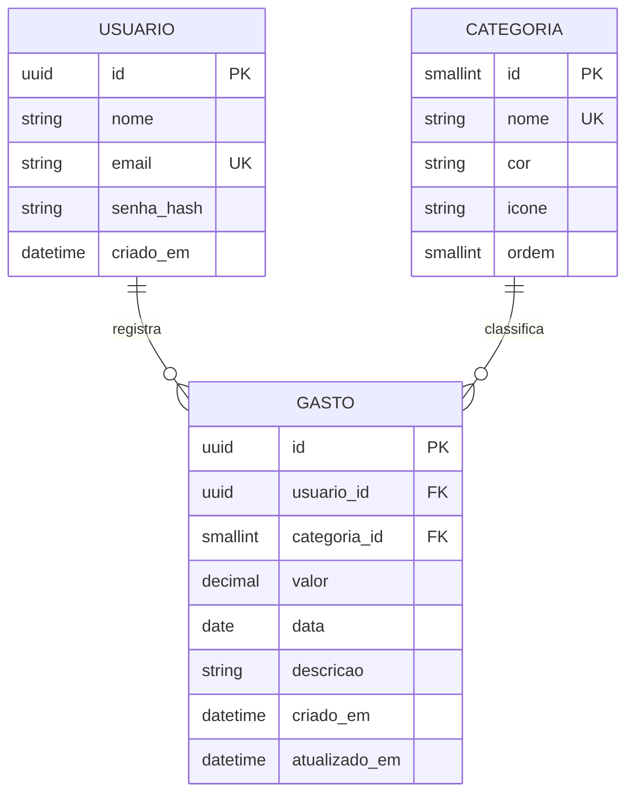

# Cadê meu dinheiro?

Aplicativo web para registrar gastos em segundos e descobrir para onde o dinheiro está indo, **sem conectar a nenhum banco**.

## Descrição do sistema
O usuário cria uma conta, anota cada gasto (valor, categoria, data e uma descrição opcional) e consulta o histórico e o resumo do mês, com o total e o gasto por categoria. Todos os dados são digitados pelo próprio usuário, e cada pessoa só vê os próprios gastos.

## Objetivo do MVP
Resolver o problema "o dinheiro entra, os dias passam e, no fim do mês, ele simplesmente sumiu". O MVP entrega o essencial para isso, com a menor fricção possível:

- criar conta e entrar (US01);
- registrar um gasto em poucos toques (US02);
- ver, editar e excluir os gastos do mês (US03, US04);
- ver o total do mês e quanto foi para cada categoria (US05, US06).

Ficam para depois: metas e limites por categoria, categorias personalizadas, lembretes e comparação entre meses.

## Tecnologias utilizadas
| Camada | Tecnologia |
|---|---|
| Frontend | React 18, Vite 5, JavaScript, CSS |
| Backend | Java 17, Spring Boot 3.3 (Spring Web, Spring JDBC), Maven |
| Banco de dados | H2 em arquivo (padrão) ou PostgreSQL |
| Segurança | Senhas com BCrypt, token de sessão assinado com HMAC-SHA256 (7 dias) |
| Testes | JUnit 5 e MockMvc (backend), `node:test` (frontend), Playwright (ponta a ponta) |

## Arquitetura da aplicação
```
 Navegador ──► Frontend React (porta 5173) ──proxy /api──► Backend Spring Boot (porta 8080) ──JDBC──► Banco (H2 ou PostgreSQL)
```
- O **frontend** é um projeto separado. Ele chama `/api/...` e o Vite repassa para o backend (`frontend/vite.config.js`), então não há problema de CORS no desenvolvimento.
- O **backend** é dividido em camadas: `controller` (recebe as requisições HTTP) → `service` (regras de negócio) → `repository` (acesso ao banco). As validações ficam em `validation`, a sessão em `security` e os erros em `exception`.
- O **banco** segue o DER do projeto (3 tabelas), criado pelo `schema.sql` ao iniciar.

```
cade-meu-dinheiro/
├── backend/    API em Java (controller, service, repository, model, dto, validation, security, exception, config)
├── frontend/   Site em React (pages, components, services, hooks, utils, styles)
├── e2e/        Teste de ponta a ponta (navegador + API + banco)
├── docs/       Documentação técnica em Markdown (requisitos, protótipos, ADRs, DER)
└── package.json   atalhos: rodar tudo e rodar testes
```
Detalhes das pastas do backend, rastreabilidade das histórias e documentação dos endpoints estão em [`backend/README.md`](backend/README.md).

## Pré-requisitos
- **JDK 17** ou superior
- **Maven 3.9** ou superior
- **Node.js 20** ou superior (inclui o npm)
- Internet na primeira execução, para baixar as dependências

## Instalação
Na pasta raiz do projeto:
```
npm run setup
```
Esse comando instala as dependências do atalho e do frontend. As dependências do backend o Maven baixa sozinho na primeira execução.

## Execução
```
npm run dev
```
Sobe o backend (porta 8080) e o frontend (porta 5173) juntos, e o navegador abre em **http://localhost:5173**. O backend leva alguns segundos para iniciar. Se aparecer "Não foi possível conectar ao servidor", espere um pouco e tente de novo.

Login de teste: `demo@exemplo.com` / `senha12345`.

Para rodar separado, em dois terminais:
```
cd backend  && mvn spring-boot:run
cd frontend && npm install && npm run dev
```

## Configuração das variáveis de ambiente
Nenhuma variável é obrigatória: tudo funciona com os valores padrão.

| Variável | Onde | Padrão | Para que serve |
|---|---|---|---|
| `PORT` | backend | `8080` | Porta da API. Se mudar, ajuste também o proxy em `frontend/vite.config.js`. |
| `APP_SECRET` | backend | aleatório a cada execução | Chave que assina os tokens de sessão. Se não for definida, os usuários precisam entrar de novo quando o backend reinicia. |
| `DADOS_TESTE` | backend | `true` | Cria o usuário de teste e alguns gastos na primeira execução. Use `false` para não criar. |
| `SPRING_DATASOURCE_URL` | backend | H2 em `backend/data/` | Endereço do banco. Exemplo para PostgreSQL: `jdbc:postgresql://localhost:5432/cade_meu_dinheiro` |
| `SPRING_DATASOURCE_USERNAME` | backend | `sa` | Usuário do banco |
| `SPRING_DATASOURCE_PASSWORD` | backend | vazio | Senha do banco |
| `BASE_URL` | teste e2e | `http://localhost:5173` | Endereço do frontend usado pelo teste de ponta a ponta |

Como definir (exemplo): no Linux/macOS, `APP_SECRET=minha-chave npm run dev`. No Windows (PowerShell), `$env:APP_SECRET="minha-chave"; npm run dev`.

## Informações sobre o banco de dados
Definido em `backend/src/main/resources/schema.sql` e executado automaticamente ao iniciar o backend.


- **Restrições:** valor entre 0,01 e 9.999.999,99; descrição de até 100 caracteres; e-mail único; ao apagar um usuário, os gastos dele são apagados junto; não dá para apagar uma categoria que tem gastos.
- **Índice:** `gasto (usuario_id, data)`, para o histórico e o resumo do mês.
- **Dados iniciais:** as 6 categorias (Alimentação, Transporte, Lazer, Moradia, Saúde e Outros) são criadas ao iniciar. O usuário de teste e 6 gastos de exemplo são criados se não houver nenhum usuário e `DADOS_TESTE` não for `false`.
- **Onde ficam os dados:** no H2 padrão, em `backend/data/`. Para recomeçar do zero, apague essa pasta com o backend parado.
- **Regra de data não futura (RN04):** é validada pela API, não pelo banco.

## Como executar os testes
| Comando | O que roda | Precisa do sistema rodando? |
|---|---|---|
| `npm run test:backend` | Testes do backend (JUnit, com banco H2 em memória) | Não |
| `npm run test:frontend` | Testes do frontend (`node:test`) | Não |
| `npm run test:e2e` | Teste de ponta a ponta com navegador | **Sim** (`npm run dev` em outro terminal) |
| `npm test` | Backend e frontend | Não |

Na primeira vez do teste de ponta a ponta, instale o navegador do Playwright: `npx playwright install chromium`.

### O que os testes cobrem
| Exigência | Onde |
|---|---|
| Histórias de usuário e critérios de aceite (CA01.x a CA06.x) | `AuthApiTest`, `GastoApiTest`, `ResumoApiTest` (cada teste indica o critério no nome) e `e2e/e2e.test.mjs` |
| Regras de negócio (RN01 a RN08) | `GastoApiTest`, `AuthApiTest`, `ResumoApiTest`, `BancoDadosTest` |
| Validações de entrada | `ValidacaoTest` e os testes de API (valor, categoria, data, descrição, e-mail, senha) |
| Tratamento de erros (400, 401, 404, 405, 409, 422) | `ErrosApiTest`, `AuthApiTest`, `api.test.js` (frontend) |
| Banco de dados (PK, FK, UNIQUE, CHECK, CASCADE) | `BancoDadosTest` |
| Interface (componentes, serviços, formatação) | `src/**/*.test.js` no frontend |
| Integração frontend, backend e banco | `e2e/e2e.test.mjs`: cria conta pela tela, registra o gasto, confere no banco pela API, recarrega a página e confirma que o dado continua lá |

## Protótipos e documentação técnica
- Wireframes das 4 telas: [`docs/03-prototipos.md`](docs/03-prototipos.md)
- Visual do frontend (cores, componentes e telas): [`docs/design-system.md`](docs/design-system.md)
- Índice completo (requisitos, requisitos não funcionais, ADRs e DER): [`docs/README.md`](docs/README.md)

## Limitações conhecidas
Categorias fixas; não há exclusão de conta nem backup automático; o H2 em arquivo serve para o MVP, mas não para produção (use PostgreSQL).
