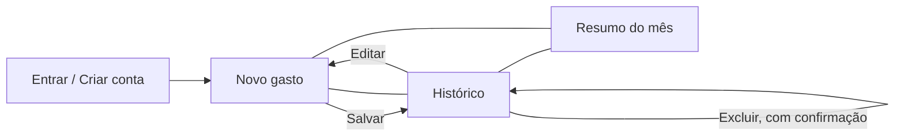

# 3. Protótipos de tela

Wireframes de baixa fidelidade das telas do MVP. Os valores são de exemplo. O código das telas está em `frontend/src/pages`.

| Tela | Histórias | O que mostra | Código |
|---|---|---|---|
| Entrar / Criar conta | US01 | Campos de e-mail e senha, botões Entrar e Criar conta. | `LoginPage.jsx` |
| Novo gasto | US02, US04 | Valor em destaque, categorias como botões de seleção, descrição opcional, data e botão Salvar gasto. Na edição, os campos vêm preenchidos. | `NovoGastoPage.jsx` |
| Histórico | US03, US04 | Seletor de mês e lista de gastos com Editar e Excluir em cada item. | `HistoricoPage.jsx` |
| Resumo do mês | US05, US06 | Total do mês e barras por categoria, da maior para a menor. | `ResumoPage.jsx` |

## 3.1 Entrar / Criar conta (US01)

```
┌──────────────────────────────────┐
│ Cadê meu dinheiro?               │
│                                  │
│ [ Entrar ]  [ Criar conta ]      │
│                                  │
│ [ E-mail                       ] │
│ [ Senha                        ] │
│                                  │
│ [            Entrar            ] │
│                                  │
│ Sem conexão com banco. Você      │
│ digita só o que gastou.          │
│                                  │
│                                  │
│                                  │
└──────────────────────────────────┘
```

## 3.2 Novo gasto (US02, US04)

```
┌──────────────────────────────────┐
│ Novo gasto                       │
│                                  │
│             R$ 0,00              │
│                                  │
│ (Alimentação) (Transporte)       │
│ (Lazer) (Moradia) (Saúde)        │
│ (Outros)                         │
│                                  │
│ [ Descrição (opcional)         ] │
│ [ Data: hoje                   ] │
│                                  │
│ [         Salvar gasto         ] │
│                                  │
│ ──────────────────────────────── │
│     »Novo  Histórico  Resumo     │
└──────────────────────────────────┘
```

## 3.3 Histórico (US03, US04)

```
┌──────────────────────────────────┐
│ Histórico                        │
│                                  │
│ [‹]     Outubro de 2026      [›] │
│                                  │
│ Almoço                  R$ 32,50 │
│ Alimentação · 15/10              │
│ Editar  Excluir                  │
│                                  │
│ Ônibus                   R$ 4,90 │
│ Transporte · 15/10               │
│ Editar  Excluir                  │
│                                  │
│ Cinema                  R$ 38,00 │
│ Lazer · 14/10                    │
│ Editar  Excluir                  │
│                                  │
│ ──────────────────────────────── │
│     Novo  »Histórico  Resumo     │
└──────────────────────────────────┘
```

## 3.4 Resumo do mês (US05, US06)

```
┌──────────────────────────────────┐
│ Resumo do mês                    │
│                                  │
│ [‹]     Outubro de 2026      [›] │
│                                  │
│ Total do mês                     │
│ R$ 1.240,00                      │
│                                  │
│ Alimentação  ████████████ R$ 480 │
│ Transporte   ████████     R$ 310 │
│ Lazer        █████        R$ 230 │
│ Moradia      ███          R$ 150 │
│ Outros       █            R$ 70  │
│                                  │
│                                  │
│ ──────────────────────────────── │
│     Novo  Histórico  »Resumo     │
└──────────────────────────────────┘
```

A navegação principal é uma barra inferior com três abas: **Novo**, **Histórico** e **Resumo** (a aba atual aparece marcada com »). Novo gasto é a aba inicial, porque registrar rápido é a ação mais frequente.

## 3.5 Fluxo de navegação

