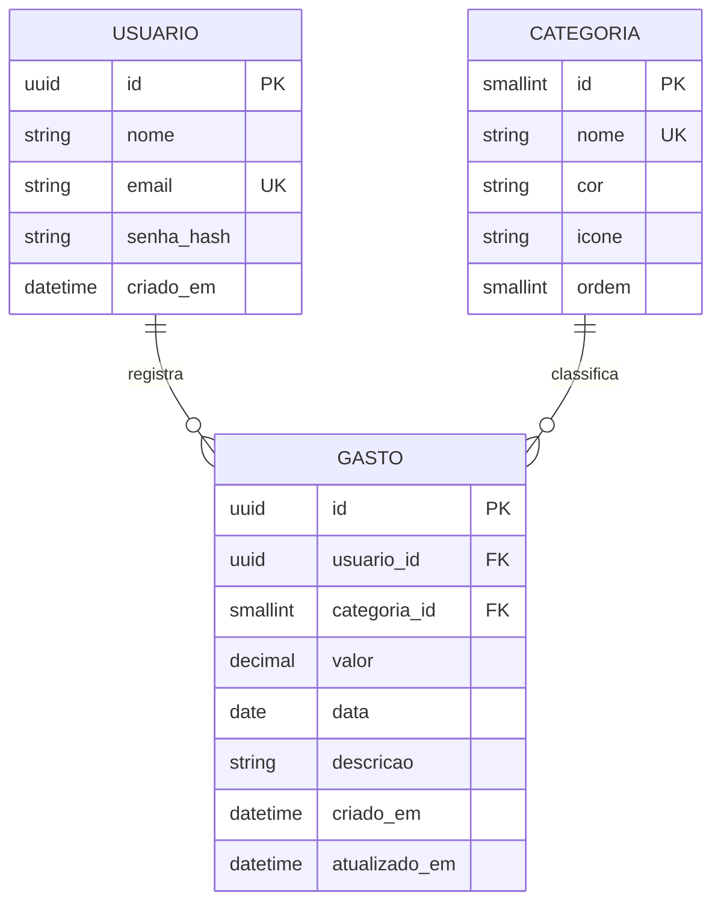

# 5. Modelagem de dados (DER)

O banco é criado pelo arquivo `backend/src/main/resources/schema.sql`.

## 5.1 Diagrama entidade-relacionamento

## 5.2 Relacionamentos
- **USUARIO 1 : N GASTO.** Um usuário registra vários gastos; cada gasto pertence a um único usuário.
- **CATEGORIA 1 : N GASTO.** Uma categoria classifica vários gastos; cada gasto tem uma única categoria.

## 5.3 Dicionário de dados

**USUARIO**

| Atributo | Tipo | Chave / restrição | Descrição |
|---|---|---|---|
| id | UUID | PK | Identificador do usuário. |
| nome | VARCHAR(80) | NOT NULL | Nome exibido. |
| email | VARCHAR(254) | UNIQUE, NOT NULL | E-mail de acesso (RN06). |
| senha_hash | VARCHAR(255) | NOT NULL | Hash BCrypt da senha (RNF10). |
| criado_em | TIMESTAMP | NOT NULL, padrão agora | Data de criação da conta. |

**CATEGORIA**

| Atributo | Tipo | Chave / restrição | Descrição |
|---|---|---|---|
| id | SMALLINT | PK | Identificador da categoria. |
| nome | VARCHAR(30) | UNIQUE, NOT NULL | Alimentação, Transporte, Lazer, Moradia, Saúde ou Outros (RN03). |
| cor | CHAR(7) | NOT NULL | Cor do gráfico, em hexadecimal. |
| icone | VARCHAR(30) | NULL | Nome do ícone. |
| ordem | SMALLINT | NOT NULL | Ordem de exibição. |

**GASTO**

| Atributo | Tipo | Chave / restrição | Descrição |
|---|---|---|---|
| id | UUID | PK | Identificador do gasto. |
| usuario_id | UUID | FK → USUARIO.id, NOT NULL, ON DELETE CASCADE | Dono do gasto (RN01). |
| categoria_id | SMALLINT | FK → CATEGORIA.id, NOT NULL | Categoria do gasto (RN03). |
| valor | NUMERIC(12,2) | NOT NULL, CHECK (valor > 0 e valor <= 9999999.99) | Valor em reais (RN02). |
| data | DATE | NOT NULL (data <= hoje validada na API) | Data em que o gasto ocorreu (RN04). |
| descricao | VARCHAR(100) | NULL | Descrição opcional (RN05). |
| criado_em | TIMESTAMP | NOT NULL, padrão agora | Quando foi registrado. |
| atualizado_em | TIMESTAMP | NOT NULL, padrão agora | Última edição. |

## 5.4 Índices e consultas principais
- Índice composto em GASTO `(usuario_id, data)` para listar o histórico e calcular totais do mês com rapidez (RNF07).
- Resumo por categoria: soma de `valor` de GASTO, filtrada por `usuario_id` e pelo intervalo de datas do mês, agrupada por `categoria_id` e ordenada pela soma, em ordem decrescente.
- Total do mês: soma de `valor` de GASTO com os mesmos filtros (RF08).

## 5.5 Rastreabilidade

| História | Requisitos | Regras | Telas | Tabelas |
|---|---|---|---|---|
| US01 | RF01, RF02 | RN06 | Entrar / Criar conta | USUARIO |
| US02 | RF03, RF04 | RN02, RN03, RN04, RN05 | Novo gasto | GASTO, CATEGORIA |
| US03 | RF05, RF10 | RN01, RN07 | Histórico | GASTO |
| US04 | RF06, RF07 | RN01, RN08 | Novo gasto (edição), Histórico | GASTO |
| US05 | RF09, RF10 | RN07 | Resumo | GASTO, CATEGORIA |
| US06 | RF08 | RN07 | Resumo | GASTO |
