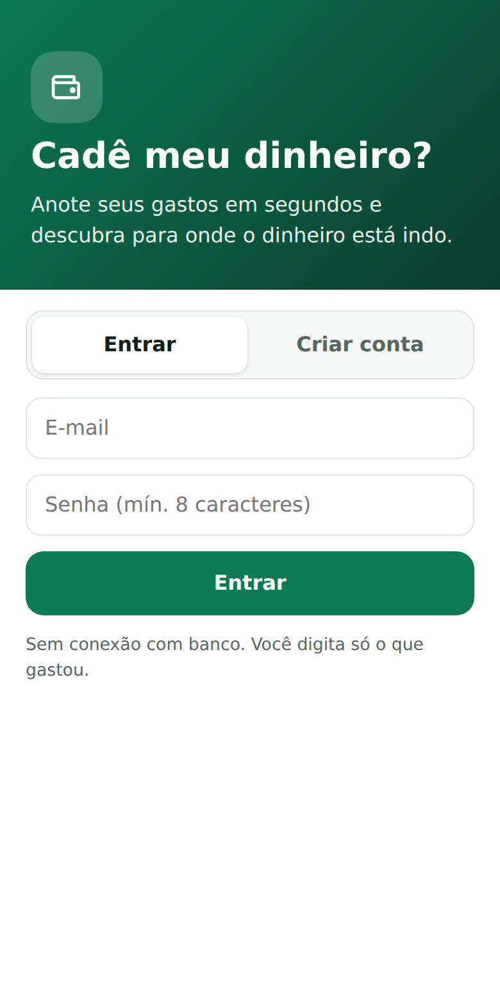
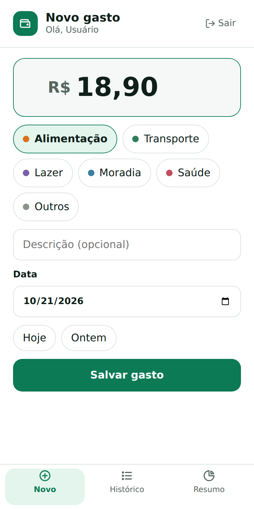
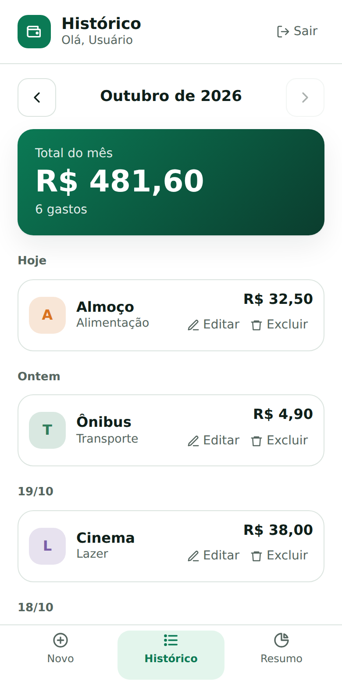
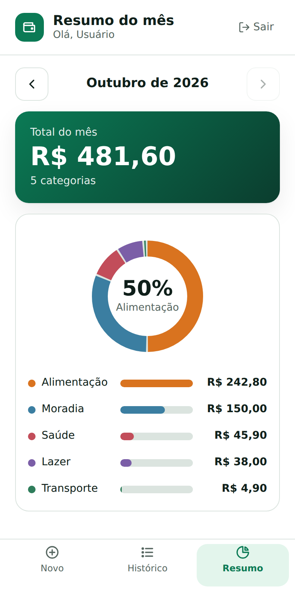
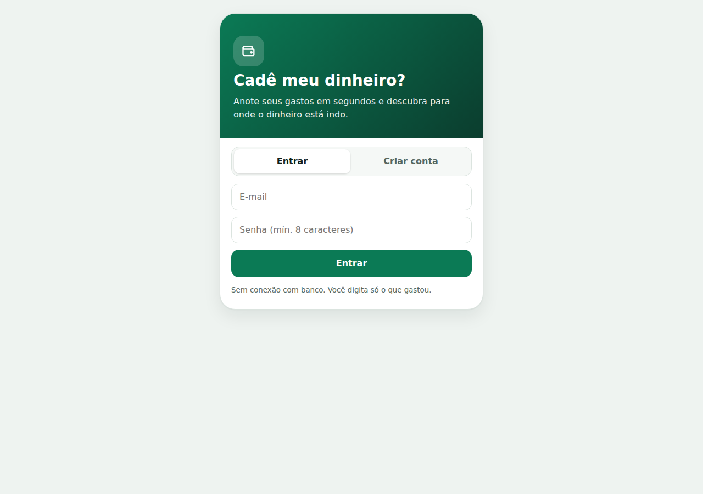

# Design system – Cadê meu dinheiro?

Visual do frontend: limpo, mobile-first e em tons de verde (dinheiro e tranquilidade). Os tokens ficam em `frontend/src/styles/tokens.css` e os estilos dos componentes em `frontend/src/styles/global.css`. Há tema claro e escuro, que segue a preferência do sistema.

## Telas

| Entrar / Criar conta | Novo gasto | Histórico | Resumo |
|---|---|---|---|
|  |  |  |  |

Versão em tela larga: 

## Cores

| Token | Claro | Escuro | Uso |
|---|---|---|---|
| `--primary` | `#0b7a55` | `#34d399` | Botões, aba ativa, destaques |
| `--primary-ink` | `#ffffff` | `#06251a` | Texto sobre a cor primária |
| `--primary-soft` | `#e3f5ec` | `#12342a` | Fundo da aba ativa e da categoria escolhida |
| `--brand-1` / `--brand-2` | `#0b7a55` / `#0b3d2e` | igual | Degradê do topo do login e do cartão de total |
| `--bg` | `#eef3f0` | `#0b110e` | Fundo da página |
| `--surface` / `--surface-2` | `#ffffff` / `#f5f8f6` | `#141d19` / `#1a2621` | Cartões, campos e áreas de apoio |
| `--ink` | `#0f1f1a` | `#eaf2ee` | Texto principal |
| `--mut` | `#566660` | `#9db0a7` | Texto secundário |
| `--line` | `#dbe4df` | `#2a3a33` | Bordas e divisórias |
| `--danger` | `#b3261e` | `#ff8a80` | Mensagens de erro |

As cores das categorias vêm do banco (campo `cor`): Alimentação `#d9731f`, Transporte `#2f7d5b`, Lazer `#7b5ea7`, Moradia `#3b7ea1`, Saúde `#c24d5a` e Outros `#8a948d`. Elas aparecem nos pontos das categorias, nos avatares da lista, na rosca e nas barras.

O texto branco sobre `--primary` tem contraste de cerca de 5:1 (WCAG AA).

## Tipografia
Fonte do sistema (`system-ui`, Segoe UI, Roboto, Arial), sem baixar fontes externas. Texto base de 16 px; valor digitado em 40 px; total do mês em 34 px; título da barra superior em 18 px; rótulos e detalhes em 12 a 14 px.

## Forma e espaçamento
- Cartões com cantos de 18 px, campos com 12 px e botões com 14 px; categorias e atalhos em formato de pílula.
- Alvos de toque de pelo menos 44 px (RNF04), exceto os links Editar e Excluir da lista, que têm 36 px de altura.
- Espaçamento de 12 a 14 px entre elementos e 20 px de margem lateral.
- Tela de até 480 px de largura; em telas maiores, o app aparece como um cartão centralizado com sombra.

## Componentes (`frontend/src/components`)
| Componente | Para que serve |
|---|---|
| `Cabecalho` | Barra superior com logo, título, saudação e botão Sair |
| `MenuInferior` | Abas Novo, Histórico e Resumo, com ícones; a atual fica destacada |
| `SeletorMes` | Mês anterior e próximo, sem passar do mês atual |
| `CartaoTotal` | Cartão verde com o total do mês |
| `ItemGasto` | Gasto com avatar colorido, descrição, categoria, valor e ações |
| `SeletorCategoria` | Categorias como botões de seleção, com ponto colorido |
| `Rosca` e `BarraCategoria` | Gráfico de rosca e barras por categoria |
| `EstadoCarga` | Indicador de carregamento e erro com "Tentar de novo" |
| `Aviso` | Mensagem de sucesso ou erro, acima do menu |
| `Icone` | Ícones SVG (novo, histórico, resumo, sair, editar, excluir, setas, carteira) |

## Acessibilidade
Ícones decorativos escondidos de leitores de tela; botões de mês com `aria-label`; aba atual com `aria-current`; foco visível; mensagens de erro com `role="alert"`; animação reduzida quando o sistema pede.
